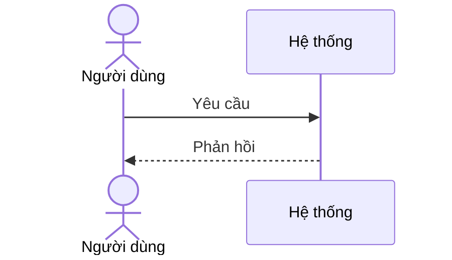

# UC-01: <Tên use case>

| Mục | Nội dung |
|---|---|
| Actor chính | |
| Actor phụ | |
| Mô tả | |
| Tiền điều kiện | |
| Hậu điều kiện (thành công) | |
| Trigger | |
| Truy vết | FR-01, US-01 |

## Luồng chính
1. Actor ...
2. Hệ thống ...
3.

## Luồng thay thế
- **2a.** <Điều kiện>:
  1. Hệ thống ...
  2. Quay lại bước 3.

## Luồng ngoại lệ
- **E1.** <Lỗi>: Hệ thống hiển thị "..." và kết thúc use case.

## Quy tắc nghiệp vụ
- RULE-01:

## Sơ đồ tuần tự

