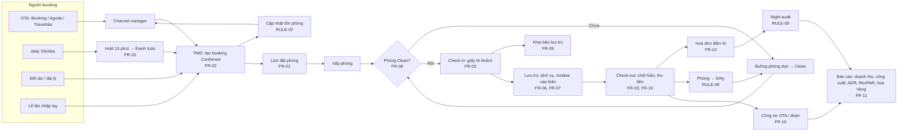
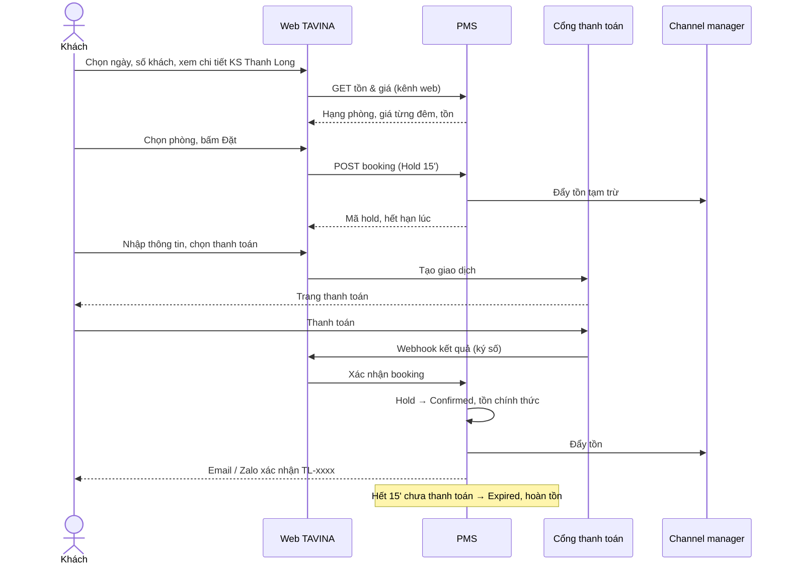
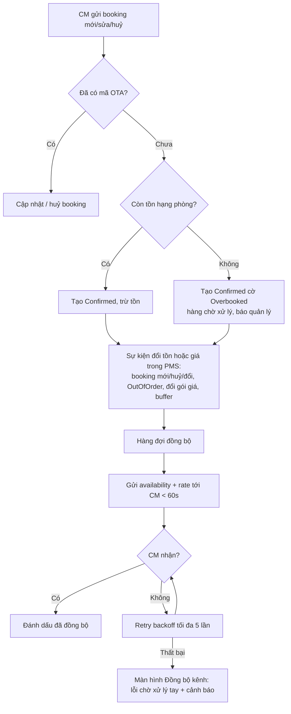
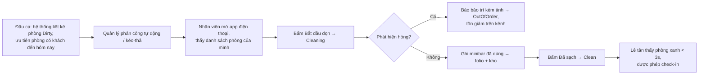

# Luồng nghiệp vụ, tham khảo UI/UX & wireframe

| Phiên bản | Ngày | Ghi chú |
|---|---|---|
| 0.1 | 2026-11-03 | Bản nháp, truy vết tới [BRD](2026-11-03-tavina-brd.md) và [SRS](2026-11-03-pms-srs.md) |

## 1. Sơ đồ luồng nghiệp vụ

### 1.1 Luồng chính: OTA → PMS → Housekeeping → Check-in/out → Hoá đơn → Báo cáo



### 1.2 Đặt phòng Thanh Long từ web (FR-15)



### 1.3 Đồng bộ hai chiều & chống overbooking (FR-02)



### 1.4 Ca làm việc housekeeping (FR-06)



## 2. Học gì từ các website tham khảo

Nguyên tắc: học **cấu trúc màn hình và luồng**, không sao chép bố cục/màu/chữ. Phần nhìn do skill `design-taste-frontend` quyết định khi làm giao diện.

### 2.1 Phần A — Web du lịch

| Site | Màn hình / luồng cụ thể | Học gì | Không làm theo |
|---|---|---|---|
| traveloka.com | Trang chủ: thanh chọn dịch vụ ngang + form tìm kiếm đổi theo dịch vụ | Một khối tìm kiếm trung tâm, tab theo dịch vụ, form nhớ lần tìm gần nhất | Quá nhiều banner khuyến mãi chồng lên nhau |
| booking.com | Trang kết quả: bộ lọc trái (giá, sao, tiện nghi, điểm đánh giá), thẻ kết quả có giá tổng cho số đêm, nhãn "chỉ còn X phòng" | Bộ lọc cố định khi cuộn; giá hiển thị là **tổng cho kỳ ở** kèm giá/đêm; thông tin tồn thật từ PMS cho Thanh Long | Nhãn giục mua giả (urgency) không dựa trên dữ liệu thật |
| agoda.com | Chi tiết khách sạn: bảng hạng phòng theo hàng (ảnh, sức chứa, chính sách huỷ, giá, nút chọn) | Bảng hạng phòng rõ ràng, chính sách huỷ nằm cạnh giá, chọn số lượng phòng từng hạng | Pop-up coupon liên tục |
| klook.com | Trang danh mục hoạt động/vé: lọc theo điểm đến, thẻ có đánh giá và "từ X đ" | Cấu trúc trang danh mục cho Vé vui chơi / Tour: lọc điểm đến, giá từ, thời lượng | — |
| vietravel.com | Trang tour: lịch khởi hành theo tháng, bảng giá người lớn/trẻ em | Trình bày tour kiểu Việt Nam: ngày khởi hành, giá theo đối tượng, lịch trình theo ngày | Trang quá dài, CTA chìm |
| saigontourist.net | Mục "Dịch vụ khác": visa, vé máy bay dạng form yêu cầu | Mẫu **form yêu cầu tư vấn** gọn cho dịch vụ chưa bán online (GĐ-A1) | — |
| ivivu.com | Combo khách sạn + vé máy bay, giá combo so với giá lẻ | Cách trình bày **combo** (FR-05): giá gói vs tổng lẻ, phần tiết kiệm | — |
| mytour.vn | Chi tiết khách sạn: tiện nghi theo nhóm, chính sách khách sạn gọn, bản đồ | Nhóm tiện nghi có biểu tượng, chính sách nhận/trả phòng tóm tắt | — |
| airbnb.com | Chi tiết chỗ ở: lưới ảnh 1 lớn + 4 nhỏ mở gallery; **lịch chọn ngày** hiện giá theo ngày và ngày không khả dụng gạch mờ; hộp đặt dính bên phải tính tổng realtime | Gallery ảnh; lịch 2 tháng với giá/đêm và ngày hết phòng mờ (dữ liệu PMS); hộp đặt dính tính tổng + phí | Thiết kế quá "lifestyle" cho khách sạn kinh doanh |

### 2.2 Phần B — PMS

| Site | Màn hình / luồng cụ thể | Học gì | Không làm theo |
|---|---|---|---|
| cloudbeds.com | Calendar: timeline phòng × ngày, kéo-thả, màu theo trạng thái, panel bên phải khi click booking; Channel manager: bảng mapping hạng phòng ↔ OTA, trạng thái đồng bộ | Cấu trúc lịch FR-01; màn hình **mapping kênh & log đồng bộ** FR-02 | Quá nhiều menu cấp 2 |
| mews.com | Timeline có thanh "hôm nay", nhóm phòng theo hạng, thao tác nhanh check-in từ lịch; Dashboard đến/đi/đang ở | Nhóm phòng theo hạng, nút thao tác trực tiếp trên booking, dashboard 3 cột đến/đi/ở | — |
| littlehotelier.com | Giao diện cho khách sạn nhỏ: ít màn hình, tạo booking 1 trang, lịch đơn giản | Mức độ tối giản phù hợp 24 phòng: form tạo booking 1 trang, ít bước | — |
| ezcloud.vn | PMS Việt: sơ đồ phòng theo tầng, hoá đơn VAT, báo cáo theo ca lễ tân, thuật ngữ tiếng Việt | Thuật ngữ và quy trình quen thuộc với lễ tân VN; báo cáo theo ca; mẫu hoá đơn | Mật độ nút quá dày |
| kiotviet.vn | Kho: nhập – xuất – tồn, kiểm kê, cảnh báo tồn tối thiểu; chấm công theo ca, bảng công | Mô hình màn hình kho FR-07 và chấm công FR-08 đơn giản, quen với chủ cửa hàng VN | — |
| hotelogix.com | Sơ đồ phòng dạng lưới ô màu theo trạng thái buồng (Clean/Dirty/OOO), lọc theo tầng, click ô mở hành động | Sơ đồ phòng/housekeeping FR-06: ô màu, chú giải, lọc tầng, hành động trong 1 chạm | Màu quá bão hoà, nhiều biểu tượng nhỏ |

## 3. Wireframe low-fi

Ký hiệu: `[ ]` nút · `( )` input · `▣` ảnh · `≡` menu · `…` lặp lại. Bố cục chỉ mô tả **cấu trúc và thứ tự ưu tiên**, không phải thiết kế cuối.

### 3.1 Trang chủ (Phần A) — desktop & mobile

```
DESKTOP (1440)                                         MOBILE (390)
┌──────────────────────────────────────────────────┐   ┌──────────────────┐
│ TAVINA   Vé máy bay Khách sạn Vé xe … Tour  [Đăng nhập]│ TAVINA        ≡  │
├──────────────────────────────────────────────────┤   ├──────────────────┤
│  h1: Câu định vị TAVINA + ảnh lớn Phú Yên (≥50%)  │   │ h1 ngắn          │
│  ┌──────────────────────────────────────────────┐ │   │ ▣ ảnh lớn        │
│  │ Tab: Khách sạn | Tour | Vé máy bay | Xe | …  │ │   │ ┌──────────────┐ │
│  │ (Điểm đến) (Ngày đến–đi) (Khách) [Tìm phòng] │ │   │ │Tab dịch vụ ▸ │ │
│  └──────────────────────────────────────────────┘ │   │ │(Điểm đến)    │ │
├──────────────────────────────────────────────────┤   │ │(Ngày) (Khách)│ │
│ Dịch vụ của TAVINA (7 card, lưới 4+3)             │   │ │[Tìm phòng]   │ │
│ ┌────┐┌────┐┌────┐┌────┐                          │   │ └──────────────┘ │
│ │Vé  ││KS  ││Vé  ││Vé  │  mỗi card: icon/ảnh,     │   ├──────────────────┤
│ │máy ││    ││xe  ││vui │  tên, 1 dòng mô tả,      │   │ Dịch vụ (cuộn   │
│ │bay ││    ││    ││chơi│  link danh mục con        │   │ ngang 7 card)    │
│ └────┘└────┘└────┘└────┘                          │   ├──────────────────┤
│ ┌────┐┌────┐┌────┐                                │   │ KS Thanh Long    │
│ │SIM ││Visa││Tour│                                │   │ ▣ ảnh, giá từ,   │
│ └────┘└────┘└────┘                                │   │ [Xem phòng trống]│
├──────────────────────────────────────────────────┤   ├──────────────────┤
│ Đối tác chiến lược: Khách sạn Thanh Long          │   │ Ưu đãi (cuộn)    │
│ ▣ ảnh lớn | tên, Phú Yên, giá từ (PMS realtime),  │   ├──────────────────┤
│   3 điểm nổi bật, [Xem phòng trống]              │   │ Cẩm nang 3 bài   │
├──────────────────────────────────────────────────┤   ├──────────────────┤
│ Ưu đãi & combo (3 thẻ)                            │   │ Footer: liên hệ, │
├──────────────────────────────────────────────────┤   │ Zalo, hotline    │
│ Cẩm nang du lịch (3 bài)                          │   └──────────────────┘
├──────────────────────────────────────────────────┤
│ Footer: địa chỉ, hotline, Zalo, giấy phép lữ hành │
└──────────────────────────────────────────────────┘
```

### 3.2 Trang danh mục (ví dụ Khách sạn — kết quả tìm kiếm)

```
┌──────────────────────────────────────────────────────────────┐
│ Breadcrumb: Trang chủ › Khách sạn › Phú Yên                   │
│ Thanh tìm kiếm thu gọn: (Phú Yên) (10–12/11) (2 khách) [Sửa]  │
├───────────────┬──────────────────────────────────────────────┤
│ BỘ LỌC (dính) │ 36 khách sạn · Sắp xếp: [Đề xuất ▾]          │
│ Giá/đêm ──●── │ ┌──────────────────────────────────────────┐ │
│ □ 2★ □ 3★ □ 4★│ │ ▣ ảnh │ KS Thanh Long  ★ Đối tác TAVINA  │ │
│ Tiện nghi     │ │       │ Tuy Hoà · 300m biển · 8.9/10     │ │
│ □ Hồ bơi      │ │       │ Còn 3 phòng Deluxe (từ PMS)      │ │
│ □ Bữa sáng    │ │       │ 2 đêm: 1.800.000đ (900.000đ/đêm) │ │
│ □ Huỷ miễn phí│ │       │ Huỷ miễn phí trước 48h  [Xem]    │ │
│ Khu vực       │ └──────────────────────────────────────────┘ │
│ □ Tuy Hoà     │ ┌──────────────────────────────────────────┐ │
│ □ Gành Đá Đĩa │ │ ▣     │ Khách sạn đối tác A (aggregator) │ │
│               │ │       │ …                                │ │
│ [Xoá lọc]     │ └──────────────────────────────────────────┘ │
│               │ …                        [1] 2 3 ›           │
└───────────────┴──────────────────────────────────────────────┘
Mobile: bộ lọc thành nút [Lọc] mở sheet; thẻ kết quả xếp dọc.
Danh mục chưa bán online (Vé máy bay, Visa…): thay bảng kết quả bằng
danh mục con dạng card + form "Yêu cầu tư vấn" (họ tên, SĐT, nhu cầu, ngày).
```

### 3.3 Chi tiết khách sạn (Thanh Long)

```
┌──────────────────────────────────────────────────────────────┐
│ ‹ Kết quả   Khách sạn Thanh Long ★ Đối tác   Tuy Hoà, Phú Yên │
│ ┌─────────────────────┬──────────┬──────────┐                │
│ │                     │ ▣        │ ▣        │  [Xem 24 ảnh]  │
│ │  ▣ ảnh chính lớn    ├──────────┼──────────┤                │
│ │                     │ ▣        │ ▣        │                │
│ └─────────────────────┴──────────┴──────────┘                │
├───────────────────────────────────────┬──────────────────────┤
│ Tabs: Phòng | Tiện nghi | Chính sách  │ HỘP ĐẶT (dính)       │
│       | Vị trí | Đánh giá             │ (10/11 → 12/11) 2 đêm│
│                                       │ (2 người lớn, 0 trẻ) │
│ HẠNG PHÒNG (dữ liệu PMS realtime)     │ Lịch 2 tháng:        │
│ ┌───────────────────────────────────┐ │  ngày có giá/đêm,    │
│ │▣ Standard · 2 khách · 22m²        │ │  ngày hết phòng mờ   │
│ │ Huỷ miễn phí trước 48h            │ │ ──────────────────── │
│ │ 700.000đ/đêm  Còn 5  (Số phòng ▾) │ │ Deluxe × 1 1.800.000 │
│ ├───────────────────────────────────┤ │ Thuế & phí     0     │
│ │▣ Deluxe · 2 khách · 28m² · ban công│ │ Tổng       1.800.000 │
│ │ 900.000đ/đêm  Còn 3  (Số phòng ▾) │ │ [Đặt phòng]          │
│ ├───────────────────────────────────┤ │ Giữ chỗ 15 phút khi  │
│ │▣ Family · 4 khách · 36m²          │ │ bấm đặt              │
│ │ Hết phòng ngày đã chọn            │ └──────────────────────┘
│ └───────────────────────────────────┘                        │
│ Tiện nghi theo nhóm · Chính sách nhận/trả phòng · Bản đồ     │
└──────────────────────────────────────────────────────────────┘
Mobile: hộp đặt thành thanh dính dưới cùng "Tổng 1.800.000đ [Đặt phòng]".
```

### 3.4 Checkout

```
┌──────────────────────────────────────────────────────────────┐
│ Bước  ● Thông tin ─── ○ Thanh toán ─── ○ Xác nhận            │
│ ⏱ Giữ chỗ còn 14:32                                           │
├───────────────────────────────────────┬──────────────────────┤
│ Thông tin người đặt                   │ TÓM TẮT ĐƠN          │
│ (Họ tên*) (SĐT*) (Email*)             │ KS Thanh Long        │
│ □ Tôi đặt cho người khác → (Tên khách)│ Deluxe × 1           │
│ (Giờ đến dự kiến ▾) (Yêu cầu đặc biệt)│ 10/11 → 12/11, 2 đêm │
│ □ Xuất hoá đơn công ty → (Tên, MST,   │ 2 người lớn          │
│   địa chỉ, email nhận HĐ)             │ ──────────────────── │
│ (Mã giảm giá) [Áp dụng]               │ 900.000 × 2 1.800.000│
├───────────────────────────────────────┤ Giảm giá        -0   │
│ Phương thức thanh toán                │ Tổng      1.800.000đ │
│ ◉ Cổng online (VNPay/MoMo/thẻ)        │ Huỷ miễn phí trước   │
│ ○ Chuyển khoản (QR, xác nhận tay)     │ 08/11 23:59          │
│ ○ Thanh toán tại khách sạn (nếu bật)  │                      │
├───────────────────────────────────────┤                      │
│ □ Tôi đồng ý điều khoản & chính sách  │                      │
│   dữ liệu cá nhân*                    │                      │
│ [Thanh toán 1.800.000đ]               │                      │
└───────────────────────────────────────┴──────────────────────┘
Xác nhận: mã TL-251110-0042, QR, nút "Thêm vào lịch", "Chat Zalo với KS",
thông tin check-in, link quản lý đơn.
```

### 3.5 Lịch booking (PMS)

```
┌────────────────────────────────────────────────────────────────────────┐
│ ≡ PMS Thanh Long   Lịch | Sơ đồ phòng | Booking | Khách | Kho | Báo cáo │
│ [Hôm nay] ‹ 10/11/2026 › Xem: [2 tuần ▾]  Lọc: (Hạng ▾)(Nguồn ▾)(TT ▾) │
│ [+ Booking mới] [+ Booking đoàn]        Chú giải: ■Web ■OTA ■Đối tác ■Quầy│
├─────────┬──┬──┬──┬──┬──┬──┬──┬──┬──┬──┬──┬──┬──┬──┬─────────────────────┤
│ Phòng   │10│11│12│13│14│15│16│17│18│19│20│21│22│23│  PANEL CHI TIẾT     │
├─────────┼──┴──┴──┼──┴──┴──┴──┼──┼──┴──┴──┼──┴──┴──┤  (khi click booking)│
│ Standard│  Nguyễn A │        │  │ Agoda  │        │ TL-251110-0042      │
│ 101     │  ■Web     │        │  │ ■OTA   │        │ Nguyễn Văn A · Web  │
│ 102     │   Trần B ■Quầy │   ▒▒ OOO ▒▒ │          │ 10→12/11 · Deluxe   │
│ 103     │        │  Booking.com ■OTA  │          │ 2 NL · 1.800.000đ    │
│ Deluxe  │        │        │           │          │ Đã thanh toán        │
│ 201     │ ═══ Đoàn Cty X (5 phòng) ═══ ■Đối tác   │ Phòng: Clean ✓       │
│ 202     │ ═══ Đoàn Cty X ═══           │          │ [Check-in] [Sửa]     │
│ 203     │ ═══ Đoàn Cty X ═══           │          │ [Đổi phòng] [Huỷ]    │
│ …       │                              │          │ Ghi chú: đến muộn    │
├─────────┼──────────────────────────────┼──────────┤ Nhật ký: tạo bởi…    │
│ Tồn/ngày│ 3│ 2│ 4│ 6│ 6│ 5│ 1│ 0│ 2│…  │          │                      │
└─────────┴──────────────────────────────┴──────────┴─────────────────────┘
Hành vi: kéo ngang = đổi ngày; kéo dọc = đổi phòng; click ô trống = tạo nhanh.
Dòng "Tồn/ngày" đỏ khi = 0; booking cờ Overbooked viền đỏ nhấp nháy.
Mobile lễ tân: thay lịch bằng 3 danh sách Đến hôm nay / Đi hôm nay / Đang ở.
```

### 3.6 Sơ đồ phòng & housekeeping

```
DESKTOP (lễ tân / quản lý)                       MOBILE buồng phòng (390)
┌──────────────────────────────────────────────┐ ┌───────────────────────┐
│ Sơ đồ phòng  Tầng: [Tất cả][1][2][3]         │ │ Ca sáng · Lan (8 phòng)│
│ Chú giải: ■Clean ■Dirty ■Cleaning ■OOO       │ ├───────────────────────┤
│ Biểu tượng: ● đang ở  ↓ đến hôm nay ↑ đi hôm nay│ │ 201  ■Dirty  ↓ đến 14h│
│ Tầng 1                                        │ │ Deluxe · khách đi 11h │
│ ┌────┐┌────┐┌────┐┌────┐┌────┐┌────┐┌────┐┌────┐│ │ [▶ Bắt đầu dọn]       │
│ │101 ││102 ││103 ││104 ││105 ││106 ││107 ││108 ││ ├───────────────────────┤
│ │■Cl ││■Di ││■Cg ││■Cl ││■OOO││■Cl ││■Di ││■Cl ││ │ 203  ■Cleaning        │
│ │ ●  ││ ↑  ││    ││ ↓  ││    ││ ●  ││ ↑  ││    ││ │ Đang dọn 12 phút      │
│ └────┘└────┘└────┘└────┘└────┘└────┘└────┘└────┘│ │ Minibar: (Nước 2)(Bia 1)│
│ Tầng 2 …  Tầng 3 …                            │ │ [✓ Đã sạch] [⚠ Báo hỏng]│
├──────────────────────────────────────────────┤ ├───────────────────────┤
│ Click ô → sheet: trạng thái, khách, booking,  │ │ 105  ■OOO bảo trì     │
│ [Đổi trạng thái] [Phân công] [Đặt bảo trì]    │ │ Điều hoà hỏng · 3 ngày│
├──────────────────────────────────────────────┤ ├───────────────────────┤
│ Phân công ca sáng: Lan 8 phòng · Hoa 7 phòng  │ │ ✓ 202  Clean 09:10    │
│ [Phân công tự động] (kéo-thả phòng giữa người) │ │ …                     │
└──────────────────────────────────────────────┘ │ ⚡ 1 thao tác chưa đồng bộ│
                                                 └───────────────────────┘
```

### 3.7 Dashboard báo cáo

```
┌──────────────────────────────────────────────────────────────────────┐
│ Tổng quan  Kỳ: [Hôm nay][Tuần][Tháng][Tuỳ chọn]  So với: kỳ trước    │
├────────────┬────────────┬────────────┬────────────┬──────────────────┤
│ Công suất  │ ADR        │ RevPAR     │ Doanh thu  │ Cảnh báo (3)     │
│ 79% ▲4     │ 820.000đ   │ 648.000đ   │ 15,5 tr ▲12%│ ⚠ 1 overbooked   │
│ 19/24 phòng│ ▲ 3%       │ ▲ 8%       │ phòng 14,2 │ ⚠ 2 chờ duyệt CK │
│            │            │            │ dịch vụ 1,3│ ⚠ Cty X quá hạn  │
├────────────┴────────────┴────────────┴────────────┴──────────────────┤
│ Hôm nay: Đến 6 · Đi 4 · Đang ở 15 · Phòng Dirty 3 · Booking mới 5    │
├──────────────────────────────────┬───────────────────────────────────┤
│ Doanh thu theo ngày (cột, 30 ngày)│ Nguồn booking (thanh ngang)       │
│ ▁▃▅▆▅▇█▆▅▃▂▄▆█▇…                  │ Web TAVINA   ████████ 32%         │
│                                  │ Booking.com  ██████ 25%           │
│                                  │ Agoda        █████ 20%            │
│                                  │ Quầy         ████ 15%             │
│                                  │ Đối tác      ██ 8%                │
├──────────────────────────────────┼───────────────────────────────────┤
│ Hoa hồng theo kênh/đối tác (bảng)│ Công suất theo hạng phòng (bảng)  │
│ Kênh | Booking | DT | HH% | HH   │ Hạng | Phòng | Bán | CS | ADR     │
│ Agoda | 12 | 9,8tr | 15% | 1,47tr│ Std | 12 | 10 | 83% | 700k        │
│ …                                │ …                                 │
├──────────────────────────────────┴───────────────────────────────────┤
│ Báo cáo chi tiết: [Doanh thu] [Chi phí & lợi nhuận] [Hoa hồng NV]    │
│ [Công nợ] [Kho] [Huỷ/No-show]                 [Xuất Excel] [Xuất PDF]│
└──────────────────────────────────────────────────────────────────────┘
Màn hình app tuân theo quy tắc app-screen của skill design-taste-frontend:
không gradient, không biểu đồ nhiều màu, số liệu thật từ night audit.
```

## 4. Lưu ý chuyển sang thiết kế & phát triển

- Giao diện public (3.1–3.4) chạy theo "the run" của `design-taste-frontend` với `--sector` du lịch/khách sạn, `--keep palette,type` nếu TAVINA đã có bộ nhận diện; ảnh thật của Phú Yên và KS Thanh Long là tài sản bắt buộc.
- Màn hình PMS (3.5–3.7) chạy theo `references/app-screens.md` của skill đó (`draw.mjs --app`).
- Kỹ thuật FE theo skill `fe`, API theo skill `be`; mỗi AC trong SRS tương ứng ít nhất một test.
