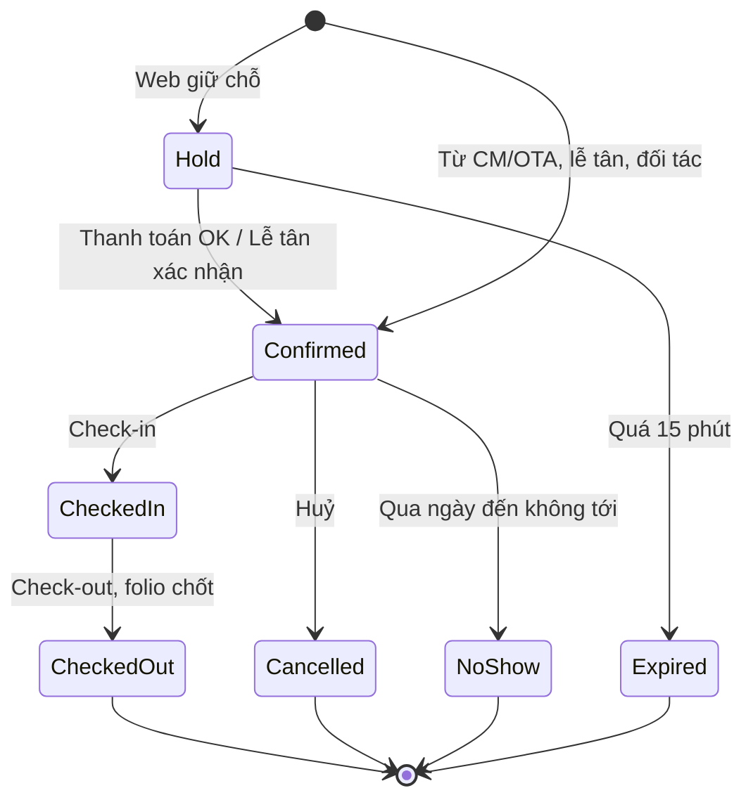
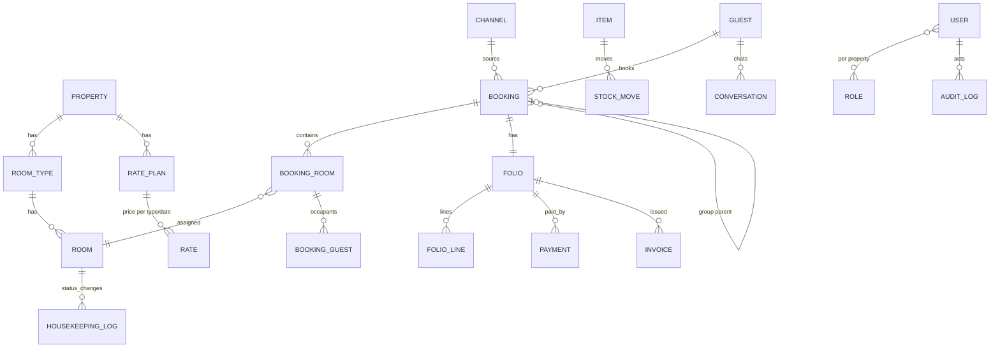

# SRS — PMS Khách sạn Thanh Long & luồng đặt phòng từ web

| Phiên bản | Ngày | Ghi chú |
|---|---|---|
| 0.1 | 2026-11-03 | Bản nháp, truy vết tới [BRD](2026-11-03-tavina-brd.md) |

## 1. Giới thiệu

- **Mục đích**: đặc tả chi tiết 14 nhóm chức năng PMS (FR-01…FR-14) và chức năng đặt phòng từ web công ty đổ vào PMS (FR-15), đủ để dev triển khai và QA viết test case.
- **Phạm vi**: Khách sạn Thanh Long, 24 phòng, 1 property; dữ liệu thiết kế multi-property.
- **Thuật ngữ**:

| Thuật ngữ | Nghĩa |
|---|---|
| Booking / Đặt phòng | Một yêu cầu lưu trú gồm 1..n phòng-đêm, có khách đặt, nguồn, trạng thái |
| Room type / Hạng phòng | Nhóm phòng cùng tiêu chuẩn và giá (ví dụ Standard, Deluxe, Family) |
| Room / Phòng | Phòng vật lý có số phòng, thuộc 1 hạng phòng |
| Rate plan / Gói giá | Bộ quy tắc giá theo hạng phòng, ngày, kênh, loại khách |
| Folio | Tài khoản chi phí của một booking/phòng: tiền phòng, dịch vụ, minibar, thanh toán |
| Night audit | Đóng ngày khách sạn, chốt doanh thu ngày, tính đêm lưu trú |
| Channel manager (CM) | Trung gian đồng bộ tồn phòng/giá với OTA và nhận booking |
| OTA | Online Travel Agency: Booking.com, Agoda, Traveloka… |
| ADR | Average Daily Rate = doanh thu phòng ÷ số phòng-đêm đã bán |
| RevPAR | Revenue Per Available Room = doanh thu phòng ÷ số phòng-đêm sẵn có = ADR × công suất |
| Hold | Giữ chỗ tạm trong lúc khách thanh toán |

## 2. Trạng thái booking (dùng chung)

Trạng thái buồng phòng: `Dirty` (bẩn) → `Cleaning` (đang dọn) → `Clean` (sẵn sàng bán) ; `OutOfOrder` (bảo trì) có thể đặt từ bất kỳ trạng thái nào và quay về `Dirty` khi kết thúc.

## 3. Yêu cầu chức năng

### FR-01 Lịch đặt phòng tổng hợp
- **Truy vết**: BR-07, UC-B01 · **Ưu tiên**: Must
- **Mô tả**: Một lịch dạng timeline (trục ngang: ngày; trục dọc: phòng nhóm theo hạng) hiển thị mọi booking từ mọi nguồn, phân biệt bằng màu theo nguồn hoặc trạng thái; hỗ trợ kéo-thả đổi phòng/ngày, click tạo nhanh.

**US-01** — Là lễ tân, tôi muốn thấy toàn bộ booking của 24 phòng trong 2–4 tuần trên một màn hình, để biết phòng nào trống và tránh xếp trùng.
- AC1: Given có booking từ web, OTA và nhập tay, When mở lịch, Then mỗi booking hiện đúng phòng, đúng khoảng ngày, màu theo nguồn, tooltip tên khách – nguồn – trạng thái.
- AC2: Given booking A ở phòng 101 ngày 10–12, When kéo A sang phòng 102 còn trống, Then hệ thống hỏi xác nhận, cập nhật phòng, ghi nhật ký, đẩy đồng bộ tồn.
- AC3 (lỗi): When kéo A sang phòng 103 đã có booking B trùng đêm, Then từ chối, giữ nguyên, báo "Phòng 103 đã có booking B (10–11/11)".
- AC4: When chọn ô trống, Then mở form tạo booking nhanh với phòng/ngày điền sẵn.
- AC5: Given 24 phòng × 31 ngày, Then lịch tải < 1,5s (NFR-02); có bộ lọc theo hạng phòng, nguồn, trạng thái; có chế độ xem ngày/tuần/tháng.

**Luồng ngoại lệ**: E1 mất kết nối khi kéo-thả → hoàn tác, báo lỗi. E2 booking đang bị người khác sửa → khoá lạc quan, báo tải lại.

**Dữ liệu**: Booking {id, mã, property_id, nguồn (web/ota:<tên>/partner/front-desk), trạng thái, khách đặt, danh sách phòng-đêm, giá từng đêm, ghi chú, created_by, timestamps}.

### FR-02 Kênh phân phối & chống overbooking
- **Truy vết**: BR-08, UC-B02, UC-B03 · **Ưu tiên**: Must
- **Mô tả**: Kết nối channel manager (GĐ-B1) để (a) nhận booking mới/sửa/huỷ từ OTA và đối tác, tự sinh booking trong PMS; (b) đẩy tồn phòng và giá theo hạng phòng × ngày × gói giá lên kênh mỗi khi thay đổi.

**US-02** — Là quản lý, tôi muốn mọi booking OTA tự vào lịch và tồn phòng tự trừ trên các kênh khác, để không bị overbooking.
- AC1: Given CM gửi booking mới (hạng Deluxe, 2 đêm), When PMS nhận, Then tạo booking trạng thái Confirmed, nguồn `ota:booking.com`, gán phòng tự động (hoặc để "chưa xếp phòng" theo cấu hình), tồn Deluxe giảm 1 cho 2 đêm, sự kiện đồng bộ gửi CM < 60s.
- AC2: Given CM gửi sửa đổi (đổi ngày) hoặc huỷ, Then booking tương ứng cập nhật/huỷ theo mã tham chiếu OTA, tồn được hoàn, ghi nhật ký.
- AC3 (lỗi): Given booking OTA đến khi hạng phòng đã hết tồn (do trễ đồng bộ), Then vẫn tạo booking với cờ **Overbooked**, đưa vào hàng chờ xử lý, cảnh báo đỏ trên dashboard và thông báo quản lý.
- AC4: Given lễ tân tạo booking tay làm tồn Standard về 0 ngày 20/11, Then trong 60s CM nhận cập nhật tồn = 0 ngày đó.
- AC5 (lỗi): When CM không phản hồi, Then retry với backoff tối đa 5 lần, sau đó ghi lỗi vào màn hình "Đồng bộ kênh" để xử lý tay.
- AC6: Quản lý cấu hình được **buffer tồn** theo hạng phòng (ví dụ giữ lại 1 phòng không bán lên OTA) và **đóng/mở bán** theo ngày/kênh.

**Quy tắc**: RULE-01, RULE-02. Idempotency theo mã booking OTA: nhận trùng không tạo đôi.

**Dữ liệu vào**: booking OTA {mã OTA, kênh, hạng phòng mapping, ngày đến/đi, số khách, tên/liên hệ, giá đã gồm/chưa gồm hoa hồng, chính sách huỷ, ghi chú}. **Dữ liệu ra**: availability {hạng phòng, ngày, tồn, trạng thái bán}, rate {hạng phòng, gói giá, ngày, giá, min stay}.

### FR-03 Tạo booking tại lễ tân (khách lẻ & đoàn)
- **Truy vết**: BR-09, UC-B04, UC-B05, UC-B06 · **Ưu tiên**: Must

**US-03** — Là lễ tân, tôi muốn tạo booking khách lẻ trong ≤ 2 phút, để phục vụ khách đến trực tiếp hoặc gọi điện.
- AC1: Given chọn ngày 10–12/11, 2 người lớn, When bấm Tìm phòng, Then hiện hạng phòng còn tồn với giá theo gói giá áp dụng (FR-04) và số phòng trống.
- AC2: When nhập khách (tìm theo SĐT → tự điền nếu đã có trong CRM), chọn phòng, hình thức thanh toán, Then booking Confirmed được tạo, mã dạng `TL-YYMMDD-XXXX`, tồn cập nhật, có thể in/gửi xác nhận qua Zalo/email.
- AC3 (lỗi): When chọn phòng đã bị người khác đặt trong lúc thao tác, Then báo và gợi ý phòng khác cùng hạng.

**US-04** — Là lễ tân, tôi muốn tạo booking đoàn nhiều phòng trong một hợp đồng, để quản lý chung tiền cọc, công nợ và danh sách phòng.
- AC1: When tạo đoàn: tên đoàn/đơn vị, người liên hệ, số phòng theo hạng, ngày, giá đoàn (FR-04), tiền cọc, hạn thanh toán, Then sinh 1 **booking cha (Group)** và n booking con theo phòng; lịch hiển thị nhóm theo đoàn.
- AC2: When nhập danh sách khách theo phòng (rooming list) bằng form hoặc import Excel theo mẫu, Then mỗi phòng con có danh sách khách để check-in và khai báo lưu trú.
- AC3: Folio đoàn có thể chọn **gộp** (một hoá đơn đơn vị) hoặc **tách** (phòng tự trả phụ thu), xem FR-10.
- AC4 (lỗi): When số phòng yêu cầu vượt tồn, Then báo thiếu bao nhiêu phòng hạng nào và cho phép tạo "chờ xác nhận" không trừ tồn.

**US-05** — Là lễ tân, tôi muốn check-in/check-out/gia hạn/đổi phòng, để cập nhật đúng tình trạng.
- AC1: Given booking Confirmed, phòng trạng thái Clean, When check-in, Then yêu cầu giấy tờ từng khách (chụp/nhập CCCD/hộ chiếu), booking → CheckedIn, phòng → Occupied, dữ liệu sẵn sàng cho khai báo lưu trú (FR-09).
- AC2 (lỗi): Given phòng Dirty/Cleaning, When check-in, Then chặn (RULE-05) và gợi ý đổi sang phòng Clean cùng hạng hoặc yêu cầu buồng phòng ưu tiên.
- AC3: When check-out, Then hiển thị folio, thu phần còn thiếu, chốt folio, booking → CheckedOut, phòng → Dirty (RULE-06), mở tuỳ chọn phát hành hoá đơn (FR-10).
- AC4: When gia hạn thêm đêm, Then kiểm tra tồn; nếu phòng hiện tại bị đặt tiếp → đề xuất đổi phòng.

**Quy tắc**: RULE-01, RULE-05, RULE-06, RULE-09. Booking Confirmed quá 24:00 ngày đến chưa check-in → cảnh báo No-show, lễ tân xác nhận chuyển trạng thái.

### FR-04 Chính sách giá & hạn mức chiết khấu
- **Truy vết**: BR-10, UC-B07 · **Ưu tiên**: Must

**US-06** — Là quản lý, tôi muốn thiết lập giá theo hạng phòng, mùa, loại khách và kênh, để hệ thống tự tính đúng giá mà không nhập tay.
- AC1: Tạo được **gói giá** với thuộc tính: tên, loại khách (lẻ/đoàn/đại lý), kênh áp dụng (web/front-desk/ota:<x>/partner), giá theo hạng phòng, **mùa** (khoảng ngày: thấp điểm/cao điểm/lễ Tết), ngày trong tuần, min stay, phụ thu người thêm, chính sách huỷ, hiệu lực từ–đến.
- AC2: Given nhiều gói giá cùng thoả, Then áp dụng theo thứ tự ưu tiên cấu hình (ví dụ: lễ Tết > cao điểm > cuối tuần > cơ bản) và hiển thị gói nào đã áp dụng trên booking.
- AC3 (lỗi): When tạo mùa trùng khoảng ngày với mùa khác cùng gói, Then báo trùng, không lưu.
- AC4: Giá đẩy lên kênh (FR-02) lấy từ gói giá gắn kênh đó; có thể đặt giá OTA = giá web × hệ số.

**US-07** — Là chủ khách sạn, tôi muốn giới hạn mức chiết khấu từng vai trò, để kiểm soát giảm giá.
- AC1: Cấu hình hạn mức %: lễ tân ≤ 5%, quản lý ≤ 15%, chủ không giới hạn (số mặc định, khách hàng chốt).
- AC2: Given lễ tân nhập chiết khấu 10%, Then booking lưu với trạng thái "chờ duyệt chiết khấu", thông báo quản lý; chỉ áp dụng khi được duyệt (RULE-04).
- AC3 (lỗi): Chiết khấu âm hoặc > 100% → từ chối.
- AC4: Mọi chiết khấu ghi nhật ký: ai đề xuất, ai duyệt, lý do.

### FR-05 Ưu đãi, combo, mã giảm giá
- **Truy vết**: BR-11, UC-B08 · **Ưu tiên**: Could (GĐ3)

**US-08** — Là quản lý, tôi muốn tạo chương trình ưu đãi và combo, để tăng doanh thu và bán chéo dịch vụ TAVINA.
- AC1: Tạo **ưu đãi**: tên, loại (giảm %, giảm tiền, tặng đêm, tặng dịch vụ), điều kiện (ngày lưu trú, min stay, kênh, hạng khách), hiệu lực, số lượt tối đa.
- AC2: Tạo **combo** = phòng + dịch vụ (tour/vé/xe từ danh mục TAVINA) với giá gói; khi khách đặt combo trên web, booking phòng vào PMS và lead dịch vụ vào CRM kinh doanh với tham chiếu chung.
- AC3: Tạo **mã giảm giá**: mã, loại, giới hạn lượt/khách, kênh; When khách nhập mã hợp lệ ở checkout, Then giá cập nhật; mã hết hạn/hết lượt → báo rõ lý do.
- AC4 (lỗi): Không cho áp 2 ưu đãi không cộng dồn lên một booking; quy tắc cộng dồn cấu hình được.

### FR-06 Tình trạng buồng phòng (housekeeping)
- **Truy vết**: BR-12, UC-B09 · **Ưu tiên**: Must

**US-09** — Là nhân viên buồng phòng, tôi muốn cập nhật trạng thái phòng trên điện thoại bằng 1–2 chạm, để lễ tân biết phòng nào bán được.
- AC1: Màn hình mobile liệt kê phòng được phân công, sắp xếp ưu tiên (khách đến hôm nay trước), mỗi phòng có nút trạng thái: Bắt đầu dọn → Đã sạch; nút Báo bảo trì (kèm ảnh/ghi chú).
- AC2: When đổi trạng thái, Then sơ đồ phòng của lễ tân cập nhật < 3s (NFR-02), ghi thời gian và người thực hiện.
- AC3 (lỗi): When mất mạng, Then thao tác được xếp hàng và gửi lại khi có mạng; hiển thị "chưa đồng bộ".
- AC4: Ghi nhận minibar đã dùng theo phòng → tự tính vào folio (FR-10) và trừ kho (FR-07).

**US-10** — Là lễ tân/quản lý, tôi muốn sơ đồ phòng theo màu trạng thái và phân công dọn phòng, để điều phối ca.
- AC1: Sơ đồ lưới theo tầng, màu: Clean (xanh), Dirty (đỏ), Cleaning (vàng), OutOfOrder (xám), kèm biểu tượng Occupied/Trống/Đến hôm nay/Đi hôm nay.
- AC2: Phân công tự động theo ca (chia đều số phòng Dirty) hoặc kéo-thả thủ công; nhân viên chỉ thấy phòng của mình.
- AC3: Đặt phòng OutOfOrder với khoảng ngày → tồn giảm trên kênh (RULE-02).
- AC4 (lỗi): When đặt OutOfOrder cho phòng đang có booking Confirmed/CheckedIn trong khoảng ngày đó, Then chặn và liệt kê booking bị ảnh hưởng để lễ tân đổi phòng trước.

### FR-07 Quản lý kho
- **Truy vết**: BR-13, UC-B10 · **Ưu tiên**: Should (GĐ3)

**US-11** — Là thủ kho, tôi muốn theo dõi nhập – xuất – tồn vật tư, minibar, đồ dùng theo định mức, để không thiếu hụt hay thất thoát.
- AC1: Danh mục vật tư: mã, tên, nhóm (minibar/đồ dùng/hoá chất/vải vóc), đơn vị, giá vốn, tồn tối thiểu, định mức/phòng.
- AC2: Phiếu nhập (nhà cung cấp, số lượng, giá, chứng từ), phiếu xuất (cho bộ phận/phòng, lý do), kiểm kê (đếm thực tế → chênh lệch).
- AC3: Minibar dùng từ FR-06 tự tạo phiếu xuất theo phòng; báo cáo tồn minibar theo phòng.
- AC4 (lỗi): Xuất vượt tồn → chặn, trừ khi quản lý xác nhận "cho âm kho" có lý do.
- AC5: Cảnh báo khi tồn < tối thiểu; báo cáo tiêu hao theo kỳ và theo số phòng-đêm bán.

### FR-08 Chấm công
- **Truy vết**: BR-14, UC-B11 · **Ưu tiên**: Should (GĐ3)

**US-12** — Là quản lý, tôi muốn phân ca và chấm công nhân viên, để xuất bảng công cuối tháng.
- AC1: Lịch ca (sáng/chiều/đêm, cấu hình giờ), phân ca theo tuần, nhân viên xem ca của mình trên điện thoại.
- AC2: Chấm công vào/ra bằng điện thoại trong bán kính GPS cấu hình (ví dụ 100m) hoặc bằng mã tại quầy; quản lý sửa công có lý do.
- AC3 (lỗi): Chấm công ngoài bán kính → ghi nhận nhưng gắn cờ chờ duyệt.
- AC4: Xuất bảng công tháng (Excel): giờ làm, ca đêm, tăng ca, nghỉ phép; **không tính lương** (ngoài phạm vi).

### FR-09 Khai báo lưu trú
- **Truy vết**: BR-15, UC-B12 · **Ưu tiên**: Must

**US-13** — Là lễ tân, tôi muốn xuất danh sách khách lưu trú đúng mẫu công an trong vài giây, để khai báo đúng hạn.
- AC1: Given khách đã check-in có giấy tờ (họ tên, ngày sinh, giới tính, quốc tịch, số CCCD/hộ chiếu, địa chỉ, ngày đến/đi dự kiến, số phòng), When chọn ngày, Then xuất file Excel/CSV theo mẫu cấu hình (cột đặt lại được) và đánh dấu "đã khai báo".
- AC2 (lỗi): Khách thiếu trường bắt buộc → danh sách lỗi theo phòng, không xuất phần thiếu, nhắc lễ tân bổ sung (RULE-08).
- AC3: Người nước ngoài tách riêng (mẫu khai báo tạm trú người nước ngoài), có nhắc nhở trong 12h kể từ check-in.
- AC4 (GĐ sau, nếu khả thi): gửi trực tiếp tới cổng dịch vụ công / hệ thống ASM của Bộ Công an qua API hoặc file chuẩn; lưu mã biên nhận.

### FR-10 Hoá đơn & công nợ
- **Truy vết**: BR-16, UC-B13, UC-B14 · **Ưu tiên**: Must (hoá đơn), Should (công nợ)

**US-14** — Là lễ tân/kế toán, tôi muốn thu tiền và phát hành hoá đơn điện tử từ folio, để không nhập lại số liệu.
- AC1: Folio gồm dòng tiền phòng theo đêm, dịch vụ, minibar, phụ thu, giảm giá, thuế, thanh toán (tiền mặt/chuyển khoản/thẻ/cổng online/OTA trả sau); số dư hiển thị realtime.
- AC2: When chốt folio và chọn Phát hành hoá đơn, Then gửi dữ liệu sang nhà cung cấp HĐĐT (GĐ-B3), nhận số hoá đơn, mã CQT, link tra cứu; lưu PDF/XML; gửi khách qua email/Zalo.
- AC3 **Tách**: chọn các dòng folio → tạo hoá đơn riêng (ví dụ tiền phòng xuất cho công ty, minibar khách tự trả). **Gộp**: nhiều folio (đoàn) → một hoá đơn cho đơn vị.
- AC4 (lỗi): Nhà cung cấp HĐĐT lỗi → hoá đơn ở trạng thái "chờ phát hành", tự thử lại, không chặn check-out; sai sót sau phát hành đi theo điều chỉnh/thay thế (RULE-07).
- AC5: Thông tin xuất hoá đơn công ty (tên, MST, địa chỉ, email) lưu vào hồ sơ khách để dùng lại.

**US-15** — Là kế toán, tôi muốn theo dõi công nợ đoàn, đại lý, OTA và đối soát, để thu đúng và đủ.
- AC1: Mỗi đối tác/đoàn có sổ công nợ: phát sinh (từ folio trả sau), thanh toán, số dư, hạn thanh toán, cảnh báo quá hạn.
- AC2: Đối soát OTA: nhập file đối soát của OTA → khớp theo mã booking → chênh lệch được liệt kê.
- AC3 (lỗi): Thanh toán vượt số dư → cảnh báo, cho phép ghi nhận thành khoản trả trước.

### FR-11 Báo cáo
- **Truy vết**: BR-17, UC-B15 · **Ưu tiên**: Must

**US-16** — Là chủ khách sạn, tôi muốn xem dashboard và báo cáo theo kỳ, để ra quyết định giá và kênh bán.
- AC1 Dashboard hôm nay: công suất, đến/đi/đang ở, doanh thu ngày, số phòng Dirty, booking mới theo kênh, cảnh báo (overbooked, quá hạn thanh toán, chờ duyệt chiết khấu).
- AC2 Báo cáo theo ngày/tuần/tháng/tuỳ chọn, có so sánh kỳ trước: **Doanh thu** (phòng/dịch vụ/minibar; theo kênh, hạng phòng), **Chi phí** (nhập kho, chi phí nhập tay theo nhóm), **Lợi nhuận gộp**, **Hoa hồng** theo kênh/đối tác/nhân viên (tỷ lệ cấu hình theo kênh và theo nhân viên bán), **Công suất**, **ADR**, **RevPAR**, **Nguồn booking**, **Huỷ/No-show**.
- AC3: Xuất Excel/PDF; số liệu lấy sau night audit (RULE-09) và đồng nhất với folio (tổng doanh thu báo cáo = tổng folio đã chốt trong kỳ).
- AC4 (lỗi): Khoảng ngày > 24 tháng → yêu cầu thu hẹp hoặc chạy nền và gửi file.

**Công thức**: Công suất = phòng-đêm bán ÷ (phòng-đêm sẵn có − OutOfOrder). ADR = doanh thu phòng ÷ phòng-đêm bán. RevPAR = doanh thu phòng ÷ phòng-đêm sẵn có.

### FR-12 CRM
- **Truy vết**: BR-18, BR-06, UC-B16, UC-B17 · **Ưu tiên**: Should (hồ sơ: GĐ1 tối thiểu), Could (chiến dịch)

**US-17** — Là lễ tân, tôi muốn một hồ sơ khách duy nhất gộp từ web, OTA và quầy, để nhận ra khách quen.
- AC1: Hồ sơ: họ tên, SĐT, email, giấy tờ (mã hoá), quốc tịch, ngày sinh, sở thích/ghi chú, thông tin xuất hoá đơn, nguồn, đồng ý nhận tin.
- AC2: Gộp trùng theo SĐT/email/số giấy tờ; gợi ý gộp khi trùng gần đúng; lịch sử lưu trú, chi tiêu, huỷ/no-show.
- AC3: Tích điểm theo quy tắc cấu hình (ví dụ 1 điểm/10.000đ tiền phòng thanh toán), phân hạng (Thường/Bạc/Vàng) theo điểm hoặc số đêm 12 tháng; hạng hiển thị khi tạo booking và trên tài khoản web.
- AC4 (lỗi): Khách yêu cầu xoá dữ liệu → ẩn danh hoá hồ sơ nhưng giữ số liệu kế toán (NFR-07).

**US-18** — Là quản lý, tôi muốn gửi chiến dịch tái sales theo phân khúc, để kéo khách quay lại.
- AC1: Lọc khách (hạng, lần ở cuối, điểm đến, đã đồng ý nhận tin) → tạo chiến dịch SMS/Zalo ZNS/email với mẫu và mã giảm giá (FR-05).
- AC2: Theo dõi gửi/mở/đặt phòng có mã; chi phí gửi ghi vào chi phí (FR-11).
- AC3 (lỗi): Khách chưa đồng ý nhận tin → bị loại khỏi danh sách gửi, không có ngoại lệ.

### FR-13 CSKH đa kênh (inbox hợp nhất)
- **Truy vết**: BR-19, UC-B18 · **Ưu tiên**: Should (GĐ3)

**US-19** — Là lễ tân, tôi muốn mọi tin nhắn Zalo OA, Messenger, email và ghi chú cuộc gọi về một inbox, để không bỏ sót khách.
- AC1: Kết nối Zalo OA và Facebook Page; tin nhắn mới hiện trong inbox < 10s với kênh, thời gian, nội dung, tệp đính kèm; trả lời từ inbox gửi về đúng kênh.
- AC2: Email vào hộp CSKH (IMAP/API) hiển thị như hội thoại; cuộc gọi hotline ghi nhận thủ công (số, nội dung) hoặc qua tổng đài có API (nếu có).
- AC3: Hội thoại tự gắn hồ sơ khách theo SĐT/ID kênh; chưa có → nút tạo hồ sơ; từ hội thoại có nút "Tạo booking" điền sẵn thông tin.
- AC4: Phân công, trạng thái (mới/đang xử lý/đã xong), mẫu trả lời nhanh, SLA cảnh báo quá 15 phút chưa trả lời.
- AC5 (lỗi): Token kênh hết hạn → cảnh báo quản trị, inbox hiển thị kênh "mất kết nối".

### FR-14 Phân quyền & nhật ký
- **Truy vết**: BR-20, UC-B19 · **Ưu tiên**: Must

**US-20** — Là chủ khách sạn, tôi muốn mỗi vai trò chỉ thấy và làm được việc của mình, và mọi thao tác quan trọng được ghi lại.
- AC1: Vai trò mặc định: Chủ, Quản lý, Lễ tân, Buồng phòng, Kế toán, Thủ kho; ma trận quyền theo chức năng × hành động (xem/tạo/sửa/xoá/duyệt/xuất); có thể tạo vai trò tuỳ chỉnh.
- AC2: Quyền gắn với property (chuẩn bị multi-property): một người có thể có vai trò khác nhau ở property khác nhau.
- AC3: Nhật ký: ai, lúc nào, hành động, đối tượng, giá trị trước/sau, IP/thiết bị cho: booking, giá, chiết khấu, folio, hoá đơn, quyền, cấu hình kênh; tìm kiếm & xuất; lưu ≥ 12 tháng (NFR-09).
- AC4 (lỗi): Truy cập URL/API không đủ quyền → 403, ghi nhật ký cố gắng truy cập.
- AC5: Đăng nhập: mật khẩu mạnh, khoá sau 5 lần sai, bắt buộc đổi mật khẩu lần đầu; 2FA cho Chủ/Quản lý (Should).

| Chức năng \ Vai trò | Chủ | Quản lý | Lễ tân | Buồng phòng | Kế toán | Thủ kho |
|---|---|---|---|---|---|---|
| Lịch & booking | Toàn quyền | Toàn quyền | Tạo/sửa/check-in-out | Xem phòng của mình | Xem | — |
| Giá & chiết khấu | Toàn quyền | Cấu hình, duyệt ≤ hạn mức | Áp ≤ hạn mức | — | Xem | — |
| Housekeeping | Xem | Phân công | Xem, yêu cầu | Cập nhật | — | — |
| Kho | Xem | Duyệt | — | Ghi minibar | Xem | Toàn quyền |
| Hoá đơn & công nợ | Toàn quyền | Xem | Phát hành | — | Toàn quyền | — |
| Báo cáo | Tất cả | Tất cả | Ca của mình | — | Tài chính | Kho |
| Phân quyền | Toàn quyền | Trừ vai trò Chủ | — | — | — | — |

### FR-15 Đặt phòng Thanh Long từ web công ty (Phần A → PMS)
- **Truy vết**: BR-03, BR-04, UC-A04, UC-A05, UC-A12 · **Ưu tiên**: Must

**US-21** — Là khách du lịch, tôi muốn thấy giá và phòng trống thật của Khách sạn Thanh Long và đặt – thanh toán ngay, để yên tâm có phòng.
- AC1: Trang chi tiết lấy hạng phòng, ảnh, tiện nghi, **tồn và giá theo ngày từ PMS** (gói giá kênh web, FR-04); đổi ngày → giá/tồn cập nhật < 1s.
- AC2: When bấm Đặt, Then PMS tạo booking **Hold** 15 phút (RULE-03), tồn tạm trừ; khách điền thông tin, chọn thanh toán (cổng online / chuyển khoản / trả tại khách sạn nếu bật).
- AC3: When cổng thanh toán báo thành công (webhook, xác minh chữ ký), Then booking → Confirmed, email/Zalo xác nhận có mã `TL-…`, tồn chính thức trừ, đồng bộ kênh.
- AC4 (lỗi): Hết 15 phút chưa thanh toán → Hold → Expired, tồn hoàn, khách được báo "giữ chỗ hết hạn" và có thể đặt lại.
- AC5 (lỗi): Thanh toán thành công nhưng hold đã hết (khách trả muộn) → vẫn tạo Confirmed nếu còn tồn; nếu hết tồn → tạo Overbooked chờ xử lý và tự thông báo lễ tân gọi khách trong 1h; không tự hoàn tiền khi chưa có quyết định.
- AC6: Khách thành viên thấy booking trong "Đơn hàng của tôi", huỷ theo chính sách huỷ của gói giá; huỷ → PMS cập nhật, hoàn tiền theo quy tắc (thủ công có xác nhận kế toán ở MVP).

## 4. Mô hình dữ liệu khái niệm

## 5. Giao diện / màn hình chính

Xem wireframe tại [Luồng nghiệp vụ & wireframe — mục 3](2026-11-03-luong-nghiep-vu-wireframe.md#3-wireframe-low-fi).

## 6. Câu hỏi mở của SRS

Gộp vào [danh sách câu hỏi chung](2026-11-03-tich-hop-mvp-cau-hoi.md#3-câu-hỏi-cần-làm-rõ-với-khách-hàng).
