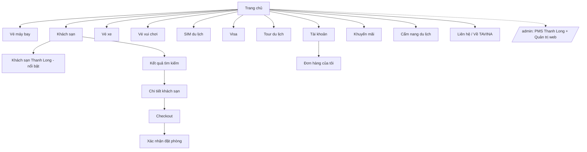

# BRD — Website Công ty Du lịch TAVINA & PMS Khách sạn Thanh Long

| Phiên bản | Ngày | Tác giả | Ghi chú |
|---|---|---|---|
| 0.1 | 2026-11-03 | BA (TAVINA) | Bản nháp đầu tiên, chờ khách hàng xác nhận giả định và câu hỏi mở |

Tài liệu liên quan: [SRS PMS](2026-11-03-pms-srs.md) · [Luồng nghiệp vụ & wireframe](2026-11-03-luong-nghiep-vu-wireframe.md) · [Tích hợp, MVP, câu hỏi mở](2026-11-03-tich-hop-mvp-cau-hoi.md)

## 1. Bối cảnh & vấn đề

Công ty du lịch TAVINA cần một website bán dịch vụ du lịch đa ngành (vé máy bay, khách sạn, vé xe, vé vui chơi, SIM, visa, tour). Đồng thời, đối tác chiến lược là **Khách sạn Thanh Long (24 phòng, Phú Yên)** đang vận hành thủ công / rời rạc: booking đến từ nhiều kênh (OTA, đối tác, lễ tân) không có một lịch chung nên dễ **overbooking**, tình trạng buồng phòng không cập nhật kịp, kho – chấm công – hoá đơn – khai báo tạm trú làm tay, không có báo cáo công suất/doanh thu theo kênh.

Hệ thống gồm hai phần dùng chung một nền tảng:

- **Phần A — Website public**: bán dịch vụ du lịch cho khách lẻ.
- **Phần B — PMS** (Property Management System): nhánh quản trị bên trong web, vận hành Khách sạn Thanh Long; là nguồn dữ liệu phòng/giá/tình trạng cho Phần A và nhận booking từ Phần A.

## 2. Mục tiêu kinh doanh

| ID | Mục tiêu | KPI đo lường | Mục tiêu số (đề xuất, cần khách hàng chốt) |
|---|---|---|---|
| BO-01 | Bán phòng Thanh Long trực tiếp, giảm phụ thuộc OTA | Tỉ lệ booking qua web công ty / tổng booking | ≥ 20% sau 6 tháng vận hành |
| BO-02 | Loại bỏ overbooking | Số ca overbooking / tháng | 0 |
| BO-03 | Tăng công suất phòng | Công suất bình quân tháng | +10 điểm % so với cùng kỳ |
| BO-04 | Giảm thời gian tác nghiệp lễ tân | Thời gian tạo 1 booking khách lẻ | ≤ 2 phút |
| BO-05 | Số liệu vận hành tức thời | Thời gian có báo cáo doanh thu ngày | ≤ 5 phút sau đóng ca (thay vì cuối tháng) |
| BO-06 | Tạo lead cho các dịch vụ du lịch khác | Số yêu cầu tư vấn / tháng từ web | Theo dõi từ tháng đầu, chốt mục tiêu sau |
| BO-07 | Tuân thủ pháp lý | Hoá đơn điện tử hợp lệ, khai báo lưu trú đúng hạn | 100% khách lưu trú được khai báo trong 24h |

## 3. Stakeholder

| Vai trò | Tên / bộ phận | Mức ảnh hưởng | Kỳ vọng |
|---|---|---|---|
| Chủ đầu tư / Sponsor | Ban giám đốc TAVINA | Quyết định | Web bán được hàng, thương hiệu chuyên nghiệp |
| Khách hàng chính | Anh Sơn — KS Thanh Long | Quyết định phần B | Vận hành gọn, hết overbooking, báo cáo rõ, dùng được trên điện thoại |
| Người dùng vận hành | Quản lý, lễ tân, buồng phòng, kế toán, kho KS Thanh Long | Cao | Dễ dùng, nhanh, ít thao tác |
| Khách du lịch | Người mua dịch vụ trên web | Cao | Tìm – chọn – đặt – thanh toán nhanh, tin cậy |
| Đối tác | OTA, khách sạn đối tác, đại lý, công ty lữ hành | Trung bình | Đồng bộ chính xác, đối soát hoa hồng |
| Cơ quan quản lý | Cơ quan thuế, công an địa phương | Ràng buộc | Hoá đơn điện tử, khai báo lưu trú đúng quy định |
| Đội phát triển | PO, dev, QA TAVINA | Thực thi | Yêu cầu rõ, kiểm thử được |

## 4. Phạm vi

### Trong phạm vi
- Phần A: trang chủ, 7 danh mục dịch vụ với danh mục con, trang chi tiết khách sạn, luồng tìm – chọn – đặt – thanh toán cho khách sạn; form yêu cầu tư vấn cho các dịch vụ còn lại; tài khoản khách, quản lý đơn hàng cá nhân.
- Phần B: 14 nhóm chức năng PMS (xem [SRS](2026-11-03-pms-srs.md)).
- Tích hợp: channel manager/OTA, API khách sạn đối tác, cổng thanh toán, hoá đơn điện tử, Zalo OA/Facebook Messenger, khai báo lưu trú (xem [tích hợp](2026-11-03-tich-hop-mvp-cau-hoi.md)).
- Bản responsive; giao diện mobile cho lễ tân và buồng phòng.
- Nền tảng dữ liệu sẵn sàng multi-property.

### Ngoài phạm vi (giai đoạn này)
- Bán vé máy bay / vé xe / vé vui chơi / SIM / visa **trực tiếp qua API nhà cung cấp** (MVP chỉ nhận yêu cầu tư vấn — giả định GĐ-A1).
- Ứng dụng mobile native (dùng web responsive / PWA).
- Kế toán tổng hợp (sổ cái, báo cáo thuế) — chỉ xuất dữ liệu cho phần mềm kế toán.
- Tính lương (chỉ chấm công, xuất bảng công).
- Điều hành tour (operator) nội bộ.
- Quản lý F&B/nhà hàng ngoài minibar.

### Giả định
| ID | Giả định | Nếu sai thì… |
|---|---|---|
| GĐ-A1 | Dịch vụ ngoài khách sạn ở MVP là lead/tư vấn, chưa bán online | Phải thêm tích hợp API nhà cung cấp từng ngành, tăng phạm vi đáng kể |
| GĐ-A2 | Khách sạn đối tác khác lấy qua **một** aggregator/API bên thứ ba | Mỗi đối tác một API riêng → chi phí tích hợp tăng theo số đối tác |
| GĐ-B1 | OTA kết nối qua **channel manager** trung gian ở MVP | Kết nối trực tiếp từng OTA cần chứng nhận đối tác, kéo dài 3–6 tháng |
| GĐ-B2 | Thanh toán online qua một cổng Việt Nam (VNPay/MoMo/ZaloPay/OnePay) | — |
| GĐ-B3 | Hoá đơn điện tử phát hành qua nhà cung cấp được Tổng cục Thuế chấp thuận (NĐ 123/2020, TT 78/2021) | — |
| GĐ-B4 | Khai báo lưu trú ở MVP là xuất file theo mẫu; tích hợp cổng dịch vụ công để giai đoạn sau | — |
| GĐ-B5 | Dữ liệu có `property_id` từ đầu; UI MVP phục vụ 1 khách sạn | — |
| GĐ-B6 | KS Thanh Long có Internet ổn định tại quầy và wifi cho nhân viên buồng phòng dùng điện thoại | Cần chế độ offline cho housekeeping |

## 5. Actor

### Phần A — Website public
| Actor | Mô tả | Quyền chính |
|---|---|---|
| Khách vãng lai | Chưa đăng nhập | Xem, tìm kiếm, gửi yêu cầu tư vấn, đặt phòng với tư cách khách |
| Khách thành viên | Đã đăng ký | Như trên + lưu hồ sơ, xem lịch sử đơn, tích điểm, huỷ/đổi theo chính sách |
| Nhân viên kinh doanh TAVINA | Nội bộ | Nhận và xử lý lead, tạo báo giá, theo dõi đơn hàng dịch vụ |
| Quản trị nội dung TAVINA | Nội bộ | Quản lý danh mục, bài viết, banner, khuyến mãi web |
| Quản trị hệ thống | Nội bộ | Cấu hình tích hợp, phân quyền, theo dõi hệ thống |
| Hệ thống ngoài | Aggregator khách sạn, cổng thanh toán | Cung cấp dữ liệu, xác nhận thanh toán |

### Phần B — PMS Khách sạn Thanh Long
| Actor | Mô tả | Quyền chính |
|---|---|---|
| Chủ khách sạn | Anh Sơn | Toàn quyền trong property; duyệt chiết khấu lớn; xem mọi báo cáo |
| Quản lý | Quản lý vận hành | Cấu hình giá/chính sách, duyệt chiết khấu theo hạn mức, báo cáo, phân ca |
| Lễ tân | Quầy lễ tân | Tạo/sửa booking, check-in/out, thu tiền, xuất hoá đơn, khai báo lưu trú, inbox CSKH |
| Buồng phòng | Nhân viên dọn phòng | Xem phân công, cập nhật trạng thái phòng, báo hỏng, dùng minibar |
| Kế toán | Kế toán | Hoá đơn, công nợ, đối soát OTA/đại lý, báo cáo tài chính |
| Thủ kho | Kho vật tư | Nhập – xuất – tồn, định mức, kiểm kê |
| Hệ thống ngoài | Channel manager/OTA, hoá đơn điện tử, Zalo/FB, cổng thanh toán, cổng lưu trú | Đẩy booking, nhận cập nhật, phát hành hoá đơn, chuyển hội thoại |

## 6. Danh sách Use case

### Phần A
| ID | Use case | Actor | Ưu tiên | Truy vết |
|---|---|---|---|---|
| UC-A01 | Duyệt trang chủ, chọn danh mục dịch vụ | Khách | Must | BR-01 |
| UC-A02 | Tìm khách sạn theo điểm đến, ngày, số khách | Khách | Must | BR-02 |
| UC-A03 | Lọc / sắp xếp kết quả khách sạn | Khách | Should | BR-02 |
| UC-A04 | Xem chi tiết khách sạn, ảnh, loại phòng, giá theo ngày, tình trạng | Khách | Must | BR-02, BR-03 |
| UC-A05 | Đặt phòng KS Thanh Long (giữ chỗ → thông tin → thanh toán → xác nhận) | Khách | Must | BR-03, BR-04 |
| UC-A06 | Đặt phòng khách sạn đối tác qua aggregator | Khách | Should | BR-02 |
| UC-A07 | Gửi yêu cầu tư vấn (vé máy bay, xe, vui chơi, SIM, visa, tour) | Khách | Must | BR-05 |
| UC-A08 | Đăng ký / đăng nhập / quản lý hồ sơ | Khách thành viên | Should | BR-06 |
| UC-A09 | Xem lịch sử đơn, huỷ/đổi theo chính sách | Khách thành viên | Should | BR-06 |
| UC-A10 | Xử lý lead, tạo báo giá, chốt đơn dịch vụ | NV kinh doanh | Must | BR-05 |
| UC-A11 | Quản lý danh mục, nội dung, banner, khuyến mãi | QT nội dung | Must | BR-01 |
| UC-A12 | Nhận webhook thanh toán, đối soát giao dịch | Hệ thống | Must | BR-04 |

### Phần B
| ID | Use case | Actor | Ưu tiên | Truy vết |
|---|---|---|---|---|
| UC-B01 | Xem lịch đặt phòng tổng hợp, kéo-thả đổi phòng/ngày | Lễ tân, Quản lý | Must | BR-07 |
| UC-B02 | Nhận booking từ OTA/đối tác qua channel manager | Hệ thống | Must | BR-08 |
| UC-B03 | Đồng bộ tồn phòng & giá lên các kênh (2 chiều) | Hệ thống | Must | BR-08 |
| UC-B04 | Tạo booking khách lẻ | Lễ tân | Must | BR-09 |
| UC-B05 | Tạo booking khách đoàn (nhiều phòng, một hợp đồng) | Lễ tân, Quản lý | Must | BR-09 |
| UC-B06 | Check-in / check-out / gia hạn / đổi phòng | Lễ tân | Must | BR-09 |
| UC-B07 | Thiết lập chính sách giá (lẻ/đoàn/mùa/kênh) và hạn mức chiết khấu | Quản lý, Chủ | Must | BR-10 |
| UC-B08 | Tạo ưu đãi, combo, mã giảm giá | Quản lý | Could | BR-11 |
| UC-B09 | Cập nhật trạng thái buồng phòng, phân công dọn phòng | Buồng phòng, Lễ tân | Must | BR-12 |
| UC-B10 | Nhập – xuất – tồn kho, định mức, kiểm kê | Thủ kho | Should | BR-13 |
| UC-B11 | Chấm công, phân ca, xuất bảng công | Quản lý, Nhân viên | Should | BR-14 |
| UC-B12 | Khai báo lưu trú (xuất mẫu / gửi cổng) | Lễ tân | Must | BR-15 |
| UC-B13 | Thu tiền, phát hành hoá đơn điện tử, tách/gộp hoá đơn | Lễ tân, Kế toán | Must | BR-16 |
| UC-B14 | Theo dõi công nợ đoàn/đại lý/OTA, đối soát | Kế toán | Should | BR-16 |
| UC-B15 | Xem báo cáo doanh thu, chi phí, lợi nhuận, hoa hồng, công suất, ADR, RevPAR | Chủ, Quản lý, Kế toán | Must | BR-17 |
| UC-B16 | Quản lý hồ sơ khách, lịch sử lưu trú, tích điểm, phân hạng | Lễ tân, Quản lý | Should | BR-18 |
| UC-B17 | Chạy chiến dịch tái sales (SMS/Zalo/email) | Quản lý | Could | BR-18 |
| UC-B18 | Xử lý hội thoại đa kênh trong một inbox, gắn hồ sơ khách | Lễ tân | Should | BR-19 |
| UC-B19 | Phân quyền theo vai trò, xem nhật ký thao tác | Chủ, Quản lý | Must | BR-20 |

## 7. Sitemap & cấu trúc danh mục

### Cấu trúc danh mục con (đề xuất)
| Danh mục | Danh mục con | Hình thức bán ở MVP |
|---|---|---|
| Vé máy bay | Nội địa · Quốc tế · Vé đoàn/doanh nghiệp · Tư vấn hành trình | Form tư vấn |
| Khách sạn | Thanh Long (ưu tiên) · Trong nước theo điểm đến (Phú Yên, Quy Nhơn, Nha Trang, Đà Lạt…) · Nước ngoài · Resort/Villa · Homestay | Đặt online (Thanh Long trực tiếp; đối tác qua aggregator) |
| Vé xe | Xe khách liên tỉnh · Xe limousine · Đưa đón sân bay · Thuê xe có tài xế | Form tư vấn |
| Vé vui chơi | Công viên/khu du lịch · Bảo tàng/di tích · Show diễn · Hoạt động ngoài trời (lặn, cano…) | Form tư vấn |
| SIM du lịch | SIM Việt Nam cho khách nước ngoài · SIM/eSIM quốc tế theo nước · Theo khu vực (châu Á, châu Âu…) | Form tư vấn |
| Visa | Visa đi nước ngoài theo nước · Visa Việt Nam cho người nước ngoài · Gia hạn · Dịch thuật/công chứng | Form tư vấn |
| Tour du lịch | Tour trong nước theo vùng · Tour nước ngoài · Tour ghép · Tour riêng/đoàn · Combo phòng + tour Phú Yên | Form tư vấn; combo với Thanh Long đặt online (GĐ3) |

## 8. Yêu cầu nghiệp vụ

| ID | Mô tả | Ưu tiên | Nguồn |
|---|---|---|---|
| BR-01 | Trang chủ trình bày 7 danh mục dịch vụ dạng card, mỗi danh mục có danh mục con, nội dung quản trị được | Must | Brief §2 |
| BR-02 | Hiển thị và bán khách sạn đối tác từ nguồn API ngoài; tìm kiếm theo điểm đến/ngày/khách, lọc, sắp xếp | Should | Brief §2 |
| BR-03 | Khách sạn Thanh Long hiển thị ưu tiên; phòng/giá/tình trạng lấy trực tiếp từ PMS theo thời gian thực | Must | Brief §2 |
| BR-04 | Booking từ web đổ thẳng vào PMS, giữ chỗ trong lúc thanh toán, xác nhận sau khi thanh toán thành công | Must | Brief §2 |
| BR-05 | Dịch vụ khác nhận yêu cầu tư vấn, chuyển thành lead cho kinh doanh xử lý | Must | GĐ-A1 |
| BR-06 | Khách có tài khoản, lịch sử đơn, tích điểm dùng chung với CRM PMS | Should | Suy ra từ §3.12 |
| BR-07 | Lịch đặt phòng tổng hợp mọi nguồn trên một màn hình | Must | Brief §3.1 |
| BR-08 | Kết nối OTA/đối tác: tự sinh booking, đồng bộ tồn phòng & giá 2 chiều, không overbooking | Must | Brief §3.2 |
| BR-09 | Lễ tân tạo booking lẻ và đoàn (nhiều phòng, một hợp đồng), check-in/out | Must | Brief §3.3 |
| BR-10 | Chính sách giá lẻ/đoàn/mùa/kênh; chiết khấu theo hạn mức quyền hạn | Must | Brief §3.4 |
| BR-11 | Ưu đãi, combo (phòng + dịch vụ TAVINA), mã giảm giá | Could | Brief §3.5 |
| BR-12 | Tình trạng buồng phòng realtime: bẩn / đang dọn / sẵn sàng / bảo trì | Must | Brief §3.6 |
| BR-13 | Quản lý kho: nhập – xuất – tồn, định mức, minibar | Should | Brief §3.7 |
| BR-14 | Chấm công nhân viên | Should | Brief §3.8 |
| BR-15 | Khai báo tạm trú theo mẫu cơ quan công an; tích hợp cổng nếu khả thi | Must | Brief §3.9 |
| BR-16 | Hoá đơn điện tử, tách/gộp, công nợ đoàn/đại lý | Must | Brief §3.10 |
| BR-17 | Báo cáo doanh thu, chi phí, lợi nhuận, hoa hồng theo kênh/đối tác/nhân viên, công suất, ADR, RevPAR | Must | Brief §3.11 |
| BR-18 | CRM: hồ sơ khách, lịch sử, tích điểm, phân hạng, chiến dịch tái sales | Should | Brief §3.12 |
| BR-19 | CSKH đa kênh (Zalo OA, Messenger, hotline, email) về một inbox gắn hồ sơ khách | Should | Brief §3.13 |
| BR-20 | Phân quyền 6 vai trò, nhật ký thao tác | Must | Brief §3.14 |
| BR-21 | Kiến trúc multi-property cho khách sạn đối tác dùng chung PMS về sau | Should | Brief §5 |

## 9. Quy tắc nghiệp vụ cốt lõi (chi tiết trong SRS)

| ID | Quy tắc |
|---|---|
| RULE-01 | Một phòng vật lý chỉ thuộc tối đa một booking trạng thái *Xác nhận/Đã nhận phòng* trên một đêm. |
| RULE-02 | Tồn phòng công bố lên kênh = phòng trống − phòng giữ (hold) − phòng bảo trì. Mọi thay đổi tồn phát sinh một sự kiện đồng bộ. |
| RULE-03 | Booking từ web giữ chỗ 15 phút chờ thanh toán; hết hạn tự giải phóng. |
| RULE-04 | Chiết khấu vượt hạn mức vai trò phải có người đủ quyền duyệt trước khi áp dụng. |
| RULE-05 | Phòng chỉ được check-in khi trạng thái buồng là *Sẵn sàng*. |
| RULE-06 | Check-out xong → phòng tự chuyển *Bẩn*. |
| RULE-07 | Hoá đơn điện tử chỉ phát hành khi folio đã được chốt; sửa sau phát hành đi theo quy trình điều chỉnh/thay thế của TT 78. |
| RULE-08 | Khách lưu trú phải có hồ sơ giấy tờ tuỳ thân để khai báo lưu trú; thiếu giấy tờ → cảnh báo tại check-in. |
| RULE-09 | Đêm lưu trú tính theo *đêm khách sạn* (night audit) lúc giờ cấu hình, mặc định 02:00. |

## 10. Yêu cầu phi chức năng

| ID | Loại | Yêu cầu đo được | Ưu tiên |
|---|---|---|---|
| NFR-01 | Hiệu năng web public | LCP < 2,5s, INP < 200ms trên 4G; trang kết quả khách sạn trả về < 3s với 200 khách sạn | Must |
| NFR-02 | Hiệu năng PMS | Lịch 24 phòng × 31 ngày tải < 1,5s; cập nhật trạng thái buồng hiển thị cho người khác < 3s | Must |
| NFR-03 | Đồng bộ kênh | Thay đổi tồn/giá đẩy tới channel manager < 60s; booking từ kênh vào PMS < 2 phút | Must |
| NFR-04 | Khả dụng | Uptime ≥ 99,5%/tháng cho PMS; bảo trì báo trước 24h | Must |
| NFR-05 | Responsive | Dùng được ở 390 / 768 / 1440px; màn hình housekeeping và check-in dùng được trên điện thoại 390px bằng một tay | Must |
| NFR-06 | Bảo mật | HTTPS toàn bộ; mật khẩu băm Argon2id/bcrypt; phân quyền theo resource; OWASP Top 10; giấy tờ tuỳ thân mã hoá khi lưu; không lưu số thẻ | Must |
| NFR-07 | Dữ liệu cá nhân | Tuân thủ Nghị định 13/2023 về bảo vệ dữ liệu cá nhân: có đồng ý, mục đích rõ, xoá theo yêu cầu | Must |
| NFR-08 | Backup | Sao lưu DB hàng ngày, giữ 30 ngày; RPO ≤ 24h, RTO ≤ 4h; diễn tập khôi phục mỗi quý | Must |
| NFR-09 | Nhật ký | Mọi thao tác tạo/sửa/xoá booking, giá, hoá đơn, quyền được ghi (ai, lúc nào, trước/sau); lưu ≥ 12 tháng | Must |
| NFR-10 | Mở rộng | Mô hình dữ liệu có `property_id`; thêm khách sạn mới không cần đổi schema | Should |
| NFR-11 | Ngôn ngữ | Web public: tiếng Việt, sẵn sàng tiếng Anh; PMS: tiếng Việt | Should |
| NFR-12 | Trình duyệt | 2 phiên bản mới nhất Chrome, Safari, Edge, Firefox; Safari iOS và Chrome Android | Must |

## 11. Rủi ro

| Rủi ro | Khả năng | Ảnh hưởng | Giảm thiểu |
|---|---|---|---|
| OTA không cấp API trực tiếp cho khách sạn nhỏ | Cao | Cao | Dùng channel manager (GĐ-B1); chọn nhà cung cấp có API mở |
| Overbooking trong lúc đồng bộ trễ | Trung bình | Cao | Hold chỗ + đồng bộ sự kiện; buffer tồn cấu hình được; cảnh báo xung đột |
| Nhân viên buồng phòng không quen dùng app | Trung bình | Trung bình | UI mobile tối giản 3 thao tác; đào tạo; có bản in lịch dọn phòng dự phòng |
| Khai báo lưu trú không có API công khai | Cao | Trung bình | MVP xuất file đúng mẫu; theo dõi cổng ASM của Bộ Công an |
| Phạm vi 14 chức năng quá lớn cho một đợt | Cao | Cao | Chia 3 giai đoạn, MVP là PMS lõi (xem lộ trình) |
| Dữ liệu khách sạn đối tác chất lượng thấp (ảnh, mô tả) | Trung bình | Trung bình | Chuẩn hoá, có bước duyệt nội dung |
| Thay đổi pháp lý hoá đơn/lưu trú | Thấp | Trung bình | Dùng nhà cung cấp hoá đơn điện tử, tách lớp tích hợp |

## 12. Câu hỏi mở

Xem danh sách đầy đủ tại [Tích hợp, MVP, câu hỏi mở — mục 3](2026-11-03-tich-hop-mvp-cau-hoi.md#3-câu-hỏi-cần-làm-rõ-với-khách-hàng).
